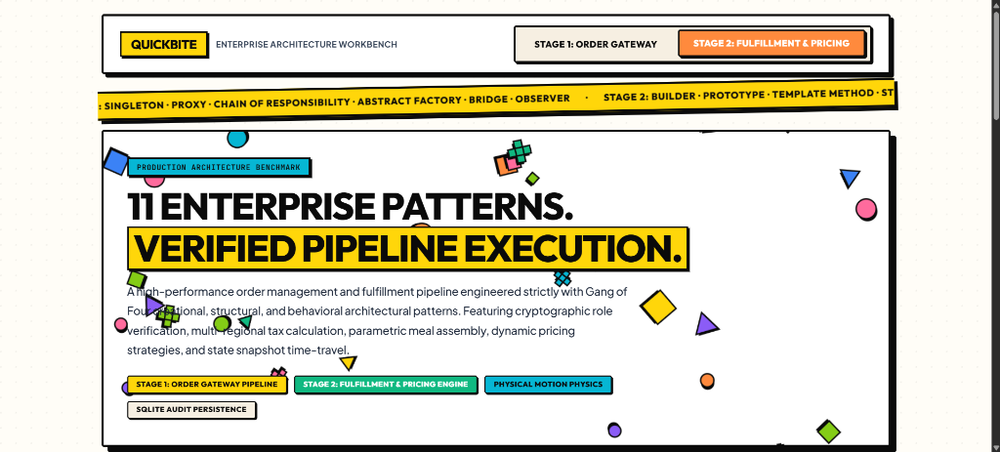
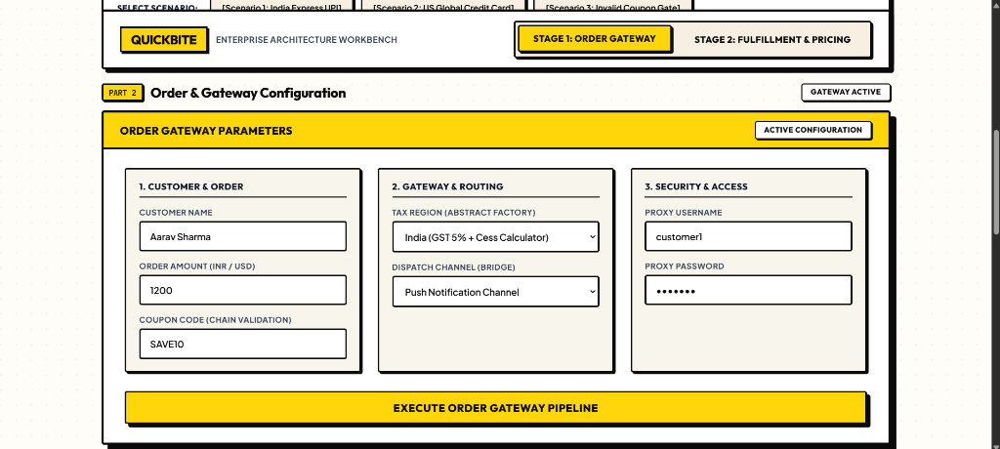
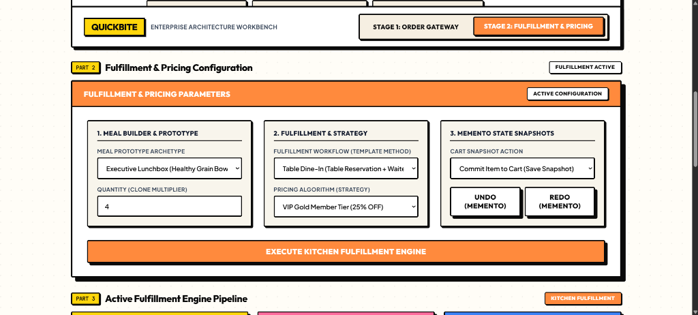
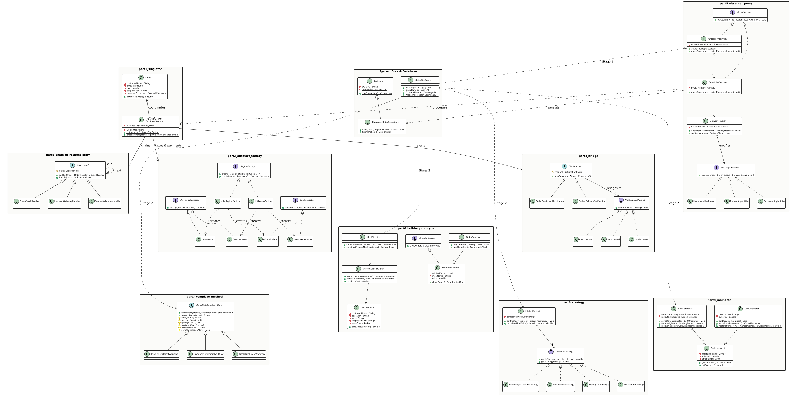
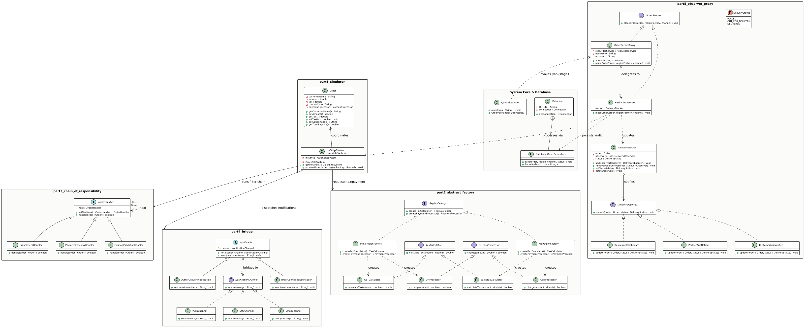
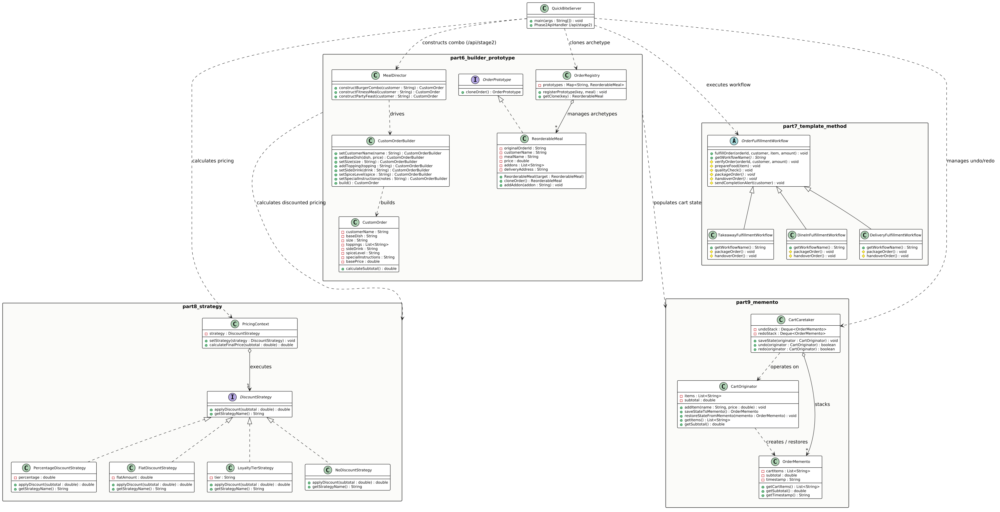

# 🍔 QUICKBITE · ENTERPRISE ARCHITECTURE WORKBENCH
### *An Interactive, Motion-Powered Food Delivery Pipeline Bringing 11 Gang of Four Patterns to Life!*

 

 

 

*A bold, high-octane engineering playground where abstract software design patterns transform into an interactive, visual food delivery engine.*

 

 

## 🎯 About QuickBite

**QuickBite** turns dusty textbook design patterns into a living, breathing software engineering experience! Instead of reading abstract diagrams about Singletons, Proxies, and Observers, QuickBite lets you configure, execute, and observe a complete high-performance restaurant ordering and kitchen fulfillment pipeline in real time.

Built with a striking **Neo-Brutalism aesthetic** - complete with chunky ink borders, vibrant playful colors, floating physics particles, and responsive 3D card tilt effects - QuickBite connects a native Java 21 backend directly to a fluid web workbench. Whether you are validating role credentials, assembling custom truffle burgers, switching between US and Indian tax calculations, or rolling back cart snapshots, every single action triggers a visible, animated architectural reaction!

> [!NOTE]
> **Zero Heavy Framework Bloat!** The entire QuickBite backend runs on Java's native standard library HTTP server (`com.sun.net.httpserver`) and SQLite JDBC, compiling in milliseconds with zero dependencies on Spring Boot or Node.js.

 

## 🔄 How It Works

Here is the journey of an order flowing through the QuickBite engine:

1. 🎛️ **Pick Your Stage** - Jump between **Stage 1 (Order Gateway)** and **Stage 2 (Fulfillment & Pricing Engine)** using the top physical tab switcher.
2. ⚡ **Choose a Preset or Customise** - Click one of the 5 one-click scenarios (like *India Express UPI* or *US Global Credit Card*), or dial in custom customer names, amounts, toppings, and fulfillment types.
3. 🚀 **Smash the Execute Button** - Hit the tactile execution button and watch the physical step-by-step pipeline animate sequentially across the screen with live telemetry.
4. 🛡️ **Pass the Security & Validation Gates** - The Proxy checks user roles, while the Chain of Responsibility inspects coupon codes and fraud checks in milliseconds.
5. 🌍 **Calculate Regional Taxes & Dispatch** - The Abstract Factory generates localized tax calculations (GST/Cess or US Sales Tax) while Bridge routes notifications via Push, SMS, or Email.
6. 🍔 **Build & Clone Meals** - The Builder stacks dishes with custom spice and drinks, while the Prototype clones saved meal archetypes instantly without state pollution.
7. 👨‍🍳 **Fulfill in the Kitchen & Settle Pricing** - The Template Method enforces kitchen inspection, packaging, and dispatch workflows while Strategy dynamically computes loyalty VIP discounts.
8. ⏪ **Time-Travel Your Cart** - Made a mistake? Click **UNDO** to trigger the Memento Caretaker, instantaneously rolling back the shopping cart to an earlier pristine snapshot!

 

## ✨ Features

  <h3>⚡ Stage 1: Secure Order Gateway & Validation Pipeline</h3>
  
    
  <h3>🍳 Stage 2: Kitchen Fulfillment & Pricing Engine</h3>
  

 

### 🛡️ Core Pipeline & Security
- 👑 **Singleton Core Coordinator** - A single, thread-safe `QuickBiteSystem` engine coordinates all database connections, transaction logs, and global order routing.
- 🔐 **Proxy Role Authentication** - `OrderServiceProxy` acts as an impenetrable security boundary, vetting credentials before delegating orders to the internal fulfillment service.
- ⛓️ **Chain of Responsibility Filter** - A linked sequence of interceptors that tests coupon validity (`SAVE10`), fraud safety parameters, and wallet balances before money changes hands.
- 🌍 **Abstract Factory Tax Engines** - Dynamically constructs cohesive families of regional financial calculators, switching between India (GST 5% + Cess) and US (8.25% State Tax) with localized receipt generation.

### 🍔 Meal Assembly & Fulfillment
- 🧱 **Parametric Meal Builder** - Assemble gourmet combos from scratch with fine-grained control over base dishes, bread types, toppings, drinks, and custom spice tolerances.
- 🧬 **1-Click Prototype Clone Registry** - Pull pre-configured meal archetypes (`WEEKLY_LUNCH`, `WEEKEND_PIZZA`) and replicate them in memory using deep copies without mutating the original template.
- 🍳 **Template Method Kitchen Lifecycles** - An invariant order fulfillment algorithm that enforces cooking, chef temperature checks, packaging, and handover while specializing for Home Delivery, Dine-In, or Takeaway.
- 🏷️ **Dynamic Strategy Pricing Engine** - Interchangeable discount algorithms allowing instant on-the-fly calculation of Gold VIP perks (25% off), seasonal sales (15% off), or flat vouchers.

### 🎨 Visuals & Workbench Experience
- ⏪ **Memento Cart Time-Travel** - Take immutable snapshots of your cart state with the `CartOriginator` and restore previous states on demand using one-click Undo/Redo.
- 📡 **Bridge Omni-Channel Alerts** - Decouples order abstractions from delivery channels, seamlessly routing alerts through Push Notifications, SMS, or Email gateways.
- 📢 **Observer Pub-Sub Broadcasting** - Simultaneously notifies customer mobile apps, live kitchen displays, and delivery partner dispatch systems the instant status transitions occur.
- ⚡ **Tactile Motion Physics** - Hardware-accelerated 3D card tilt on hover, animated numerical ticker counters, drifting canvas physics particles, and celebratory victory confetti blasts!
- 💾 **SQLite Audit Persistence** - Every single transaction and fulfillment ticket is automatically saved into a local SQLite database (`orders.db`) for audit inspection.

> [!TIP]
> **Try the Memento Time-Travel!** Switch to Stage 2, add experimental coupons or extra sides, then click the **UNDO (MEMENTO)** button. Watch the telemetry console and status badge flash as the cart state is rewound in memory!

> [!TIP]
> **Check Out the Live Telemetry Stream!** Every single architectural pattern emits a dedicated color-coded telemetry badge (`[PROXY]`, `[CHAIN]`, `[BUILDER]`, `[STRATEGY]`, etc.) directly into the light-mode audit console. You can even copy the audit log with one click!

 

## 💡 Who Can Use This?

| 👤 Who | 🎯 What they do with QuickBite |
|---|---|
| **🎓 CS Students** | Experience how Gang of Four patterns actually cooperate in a real full-stack project instead of isolated console exercises. |
| **🎨 Frontend Designers** | Explore how to build rich Neo-Brutalist interfaces with high-contrast borders, custom typography, and physical motion. |
| **☕ Java Enthusiasts** | Study how to build a lightning-fast native REST API without relying on bulky heavyweight frameworks. |
| **👩‍🏫 Professors & TAs** | Run live classroom demos where students can visually observe design patterns triggering in real time. |
| **💼 Interview Preppers** | Cement intuitive mental models for System Design and Object-Oriented Design (LLD) interview questions. |
| **🍔 Foodtech Explorers** | Peek into the structural patterns that power enterprise food delivery apps like Zomato, Swiggy, and UberEats. |

> [!IMPORTANT]
> **Perfect for Interactive Demonstrations:** Teachers and presenters can use the 5 built-in presets to trigger successful deliveries, authentication failures, and coupon rejections within seconds without typing a single word!

 

## 🛠️ Built With

| Technology | Role in QuickBite |
|:---|:---|
|  | Powers the high-performance backend, HTTP endpoints, and all 11 design pattern implementations. |
|  | Lightweight relational database engine persisting settled order audits and payment logs in `orders.db`. |
|  | Clean, semantic structure for both the Order Gateway and Fulfillment Workbench views. |
|  | Custom Neo-Brutalist design system featuring CSS design tokens, ink borders, and tactile shadows. |
|  | Orchestrates asynchronous REST API calls, dynamic card rendering, and stage tab transitions. |
|  | Drives hardware-accelerated card reveals, interactive 3D perspective tilts, and confetti particles. |
|  | Modern localized typography pairing **Outfit** for bold headlines and **Plus Jakarta Sans** for body UI. |

 

QuickBite intentionally avoids heavy framework dependencies like Spring Boot, React, or Tailwind, proving that extraordinary visual polish and rock-solid enterprise architecture can be achieved with pure, native web and Java primitives!

 

## 📸 Architecture Diagrams & Workbench Visuals

  <h3>🏛️ Complete Master Architecture Diagram (All 9 Parts + Core Engine)</h3>
  
   
  *Unified Enterprise System Hierarchy: 11 Gang of Four Patterns across 9 Modular Packages & Native HTTP Engine*

    

  <h3>⚡ Stage 1 Architecture Deep-Dive (Parts 1 - 5: Order Gateway & Security Pipeline)</h3>
  
   
  *Patterns: Singleton · Abstract Factory · Chain of Responsibility · Bridge · Proxy · Observer*

    

  <h3>🍳 Stage 2 Architecture Deep-Dive (Parts 6 - 9: Kitchen Fulfillment & Dynamic Pricing Engine)</h3>
  
   
  *Patterns: Builder · Prototype · Template Method · Strategy · Memento*

 

  <h3>✨ Neo-Brutalism Interactive Workbench Interface</h3>
  
   
  *Neo-Brutalism Workbench Hero with Live Generative Canvas Physics*

 

## 🤓 Did You Know?

> [!NOTE]
> 💬 **9 Modular Parts, 11 Patterns:** The codebase is neatly partitioned into 9 standalone packages (`part1_singleton` through `part9_memento`), demonstrating how structural, creational, and behavioral patterns cleanly coexist without stepping on each other's toes!

> [!NOTE]
> 💬 **Zero-Copy Deep Cloning:** The `OrderRegistry` in Part 6 uses explicit copy constructors to clone collections and metadata, guaranteeing that modifying an item in a cloned order can never mutate the original archetype!

> [!NOTE]
> 💬 **Interactive Physics in Pure Canvas:** The floating shapes bouncing behind the hero headline are computed in real time on an HTML5 `<canvas>` using custom 2D particle dynamics and collision geometry!

> [!NOTE]
> 💬 **Sub-20ms Pipeline Latency:** Because the entire stack operates in-memory with native Java I/O and embedded SQLite, a full 6-step gateway pipeline executes in under 20 milliseconds!

 

### Made with ❤️ by the Developer

 

